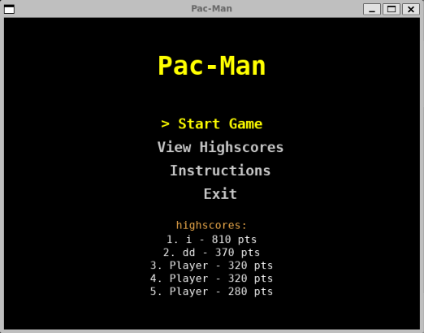
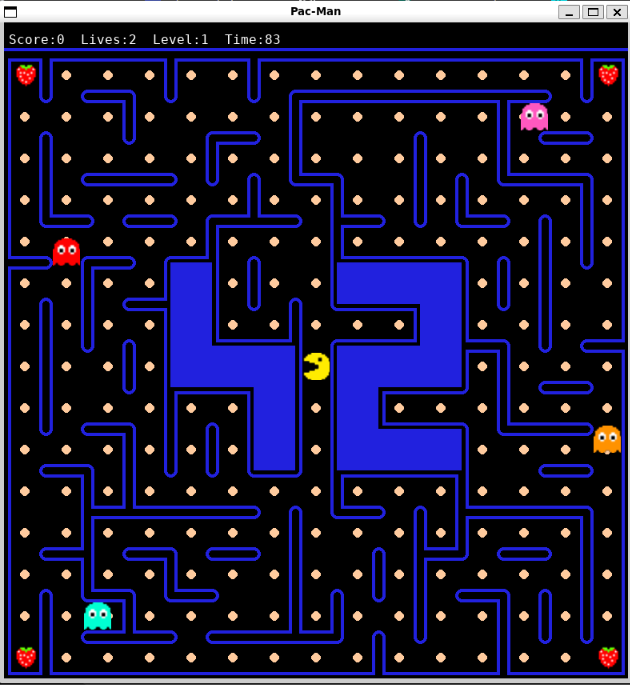
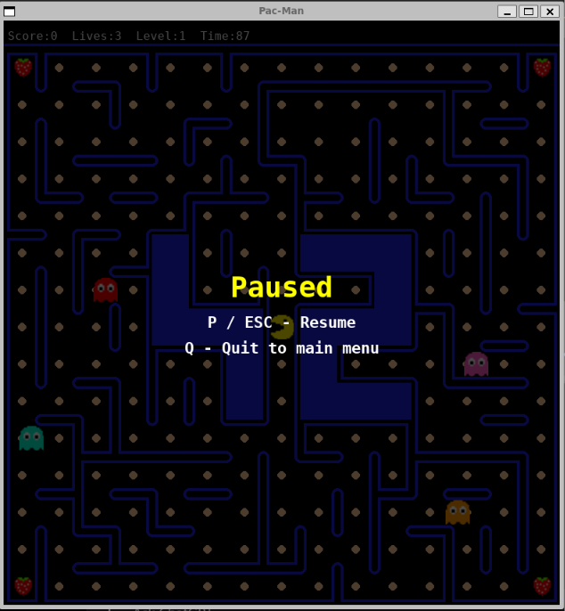
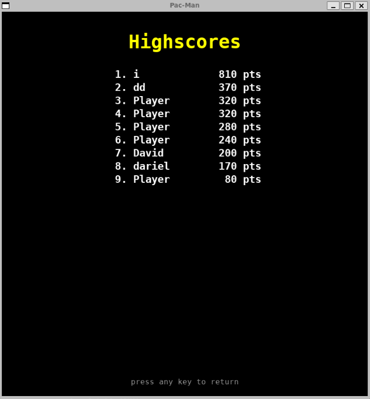
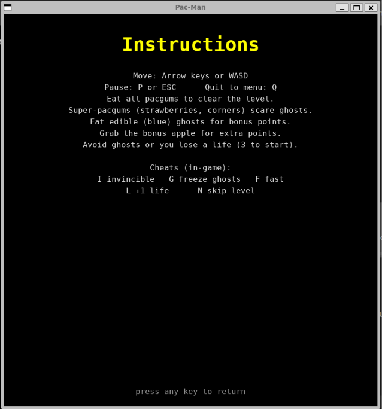
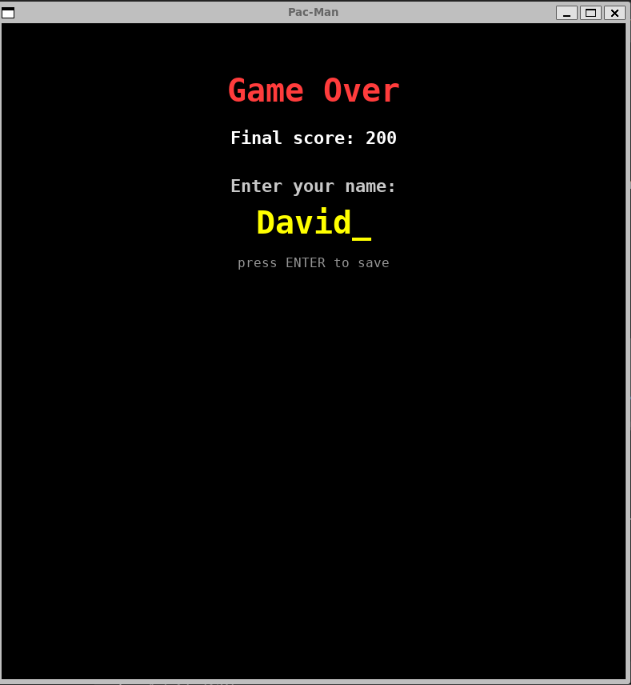

# Pac-Man

*A 42 curriculum project by ddervish and dshabani.*

A Python recreation of the classic Pac-Man arcade game, built with **Pygame** and procedurally generated mazes using the assigned **A-Maze-ing** package.

The player navigates increasingly large mazes, collects pacgums and bonus items, avoids four ghosts, and tries to achieve a place in the persistent top-10 high-score table.

**Project page:** https://danjel42.itch.io/pacman-42

## Screenshots

| Main menu | Gameplay |
| --- | --- |
|  |  |

| Pause menu | High scores |
| --- | --- |
|  |  |

| Instructions | Game over |
| --- | --- |
|  |  |

## Features

- **Procedural mazes:** levels are generated through the assigned A-Maze-ing package.
- **Progressive levels:** the game supports at least ten levels, with configurable maze dimensions.
- **Four ghosts:** Blinky, Pinky, Inky and Clyde use distance-based movement with individual random biases.
- **Pacgums and super-pacgums:** collect ordinary dots to progress and strawberry items to frighten ghosts.
- **Bonus fruit:** an apple can appear during gameplay and award additional points.
- **Persistent high scores:** scores are stored in JSON and the top ten are retained.
- **Game states:** menu, gameplay, pause, instructions, high scores, game over and victory screens.
- **Configuration:** gameplay settings can be adjusted through a JSON configuration file with comment support.
- **Peer-review cheats:** optional gameplay shortcuts make it easier to demonstrate specific mechanics.

## Technologies

- Python 3.10+
- Pygame
- A-Maze-ing maze generator
- JSON for configuration and persistent high scores
- flake8 and mypy for code-quality checks

## Getting started

### Requirements

- Python 3.10 or newer
- pip

### Installation

Clone the repository and enter its directory:

```bash
git clone https://github.com/42learners/Common-core---Pacman-226b955c-7cf4-4a95-9356-93f77ab0b825.git
cd Common-core---Pacman-226b955c-7cf4-4a95-9356-93f77ab0b825
```

Create and activate a virtual environment:

```bash
python3 -m venv .venv
source .venv/bin/activate
```

Install the dependencies:

```bash
python -m pip install --upgrade pip
python -m pip install pygame
python -m pip install ./mazegenerator-00001-py3-none-any.whl
```

### Run the game

```bash
python pac-man.py config.json
```

The entry point expects exactly one argument: the path to a `.json` configuration file.

The project also provides Makefile commands:

```bash
make run
make debug
make lint
make lint-strict
make clean
```

- `make run` starts the game with `config.json`.
- `make debug` starts it through Python's debugger.
- `make lint` runs flake8 and mypy with the project's configured checks.
- `make lint-strict` runs the stricter mypy configuration.
- `make clean` removes generated cache files.

## Controls

| Action | Keys |
| --- | --- |
| Move | Arrow keys or W, A, S, D |
| Pause / resume | P or ESC |
| Quit to menu while paused | Q |
| Navigate menus | Up / Down |
| Select menu option | Enter or Space |

### Peer-review cheat keys

These shortcuts are available during gameplay to help demonstrate the mechanics:

| Key | Effect |
| --- | --- |
| I | Toggle invincibility |
| G | Freeze / unfreeze ghosts |
| F | Toggle increased player speed |
| L | Add one life |
| N | Advance to the next level |

Active cheats are indicated in red in the HUD.

## Configuration

The game reads its settings from `config.json`. The parser supports full-line comments beginning with `#` or `//`, as well as `/* ... */` block comments.

Invalid or out-of-range values are handled through validation and safe defaults. Unknown configuration keys are ignored.

| Setting | Default | Description |
| --- | --- | --- |
| `highscore_filename` | `highscores.json` | File used to store high scores |
| `lives` | `3` | Starting number of lives |
| `pacgum` | `42` | Accepted configuration value |
| `points_per_pacgum` | `10` | Points for an ordinary pacgum |
| `points_per_super_pacgum` | `50` | Points for a super-pacgum |
| `points_per_ghost` | `200` | Points for eating a frightened ghost |
| `seed` | `42` | Initial level's maze-generation seed |
| `level_max_time` | `90` | Time limit per level, in seconds |
| `level` | Configured list | Array of maze dimensions |

Each configured maze dimension is constrained to the range 7–17. At least ten levels are available; levels without a configured size use a 15 × 15 maze. The first level uses the configured seed, while subsequent levels use random seeds.

## Maze generation

Maze generation is handled by the assigned `mazegenerator.MazeGenerator` package. The project uses the generator as an external dependency rather than modifying its implementation.

The generated maze uses bitmask values to represent walls:

| Direction | Bit value |
| --- | --- |
| North | 1 |
| East | 2 |
| South | 4 |
| West | 8 |

A cell with the value `15` represents a solid block.

The game interprets the generated grid to identify walkable corridors and reachable cells. Pacgums are placed throughout the reachable area, while super-pacgums and ghosts are positioned near the corners and Pac-Man starts near the centre.

A breadth-first search checks which cells are reachable, helping ensure that collectibles are placed in accessible parts of the maze.

The generator can become slow or recurse deeply with larger maze dimensions. The project's maze-loading code therefore:

- Limits maze dimensions to a maximum of 17.
- Applies a generation time budget where `SIGALRM` is available.
- Retries failed generation attempts with different seeds.
- Temporarily raises the recursion limit during generation and restores it afterwards.

If all generation attempts fail, the game reports an error rather than continuing with an invalid maze.

## Gameplay and implementation

### Player movement

Movement is grid-based, with pixel interpolation between cells to produce smoother movement. The player can buffer a direction so that a turn is taken when the next cell becomes accessible.

### Ghost behaviour

Ghost movement uses Manhattan distance to evaluate possible moves. In normal mode, ghosts favour moves that bring them closer to Pac-Man. When frightened, they favour moves that increase the distance.

Each ghost has an individual random bias, adding variation to its movement. Immediate reversals are avoided where possible.

### Collectibles and scoring

- Ordinary pacgums award the configured ordinary-pacgum score.
- Super-pacgums award their configured score and activate frightened mode for the ghosts.
- Eating a frightened ghost awards the configured ghost score and sends it back to its home position.
- A randomly appearing apple provides an additional bonus.

### Lives, levels and high scores

The player starts with the configured number of lives. Collisions with non-frightened ghosts cost a life unless invincibility is active.

A level is completed when its pacgums and super-pacgums have been collected. The game then progresses to the next level.

High scores are stored in a JSON file. On loading, entries are validated, names are limited to ten characters, scores are sorted, and only the top ten are retained. Missing or invalid high-score files are handled without preventing the game from starting.

## Project structure

The project separates the game into a small Python package:

```text
.
├── pac-man.py
├── config.json
├── highscores.json
├── mazegenerator-00001-py3-none-any.whl
├── pacman-art/
│   ├── ghosts/
│   ├── other/
│   ├── pacman-down/
│   ├── pacman-left/
│   ├── pacman-right/
│   └── pacman-up/
├── pacman/
│   ├── __init__.py
│   ├── app.py
│   ├── config.py
│   ├── constants.py
│   ├── entities.py
│   ├── game.py
│   ├── highscores.py
│   └── maze.py
├── project-management/
│   └── README.md
├── DEPLOYMENT.md
├── Makefile
├── build.sh
├── pyproject.toml
└── setup.cfg
```

### Main modules

| Module | Responsibility |
| --- | --- |
| `pac-man.py` | Application entry point |
| `pacman/app.py` | Command-line argument validation and application startup |
| `pacman/config.py` | Configuration parsing, validation and default handling |
| `pacman/constants.py` | Shared constants, directions and maze definitions |
| `pacman/maze.py` | Maze-generator integration and grid traversal helpers |
| `pacman/entities.py` | Level construction, collectible placement and ghost entities |
| `pacman/game.py` | Game state machine, gameplay updates, input and rendering |
| `pacman/highscores.py` | High-score loading, validation, sorting and persistence |

## Code quality and verification

The project includes flake8 and mypy checks through its Makefile.

The following checks were run during the project review:

```bash
make lint
```

The lint and type-check command completed successfully, reporting no issues in the nine source files checked.

The game was also launched and manually exercised. Gameplay, movement, ghosts, collectibles, pause and resume, and high-score handling were checked during interactive testing.

No separate automated unit-test suite is included in the repository.

## Packaging and deployment

The repository includes `build.sh`, which is configured to prepare a standalone executable using PyInstaller and package the resulting build for distribution.

The deployment instructions are documented in [DEPLOYMENT.md](DEPLOYMENT.md).

The build script is provided as part of the project; a separate successful standalone build is not claimed here.

## Collaboration

This was a two-person project completed as part of the 42 curriculum by **ddervish** and **dshabani**.

The original project documentation identifies both contributors. The following is a retrospective summary of the main areas of responsibility during development, rather than a claim that the original Git history proves individual authorship of every file or line.

**dshabani — primary areas of responsibility:**
- Configuration system and value validation.
- Persistent high-score handling.
- Menu and interface presentation.
- HUD and end-screen presentation.
- Packaging and deployment documentation.

**ddervish — primary areas of responsibility:**
- Maze-generator integration and maze handling.
- Level construction and entity placement.
- Player and ghost movement.
- Ghost behaviour and core gameplay mechanics.
- Collision handling.

**Joint work:**

Overall design decisions, architecture, integration, testing, debugging, gameplay balancing and final delivery were collaborative.

The codebase was developed and integrated as a shared project. The responsibility summary above should not be interpreted as a file-by-file authorship record.

Further planning notes are available in [project-management/README.md](project-management/README.md).

## AI assistance

AI tools were used as development support to explore the maze generator's bitmask representation, consider implementation structure, review configuration and high-score handling, and assist with code-quality considerations.

The resulting implementation was reviewed and tested by the project contributors. AI assistance is disclosed here as part of the development process.

## Acknowledgements

- The 42 curriculum and project subject.
- The assigned A-Maze-ing maze-generator package.
- Pygame and its documentation.
- Jamey Pittman's *The Pac-Man Dossier* for reference on Pac-Man mechanics and ghost behaviour.
